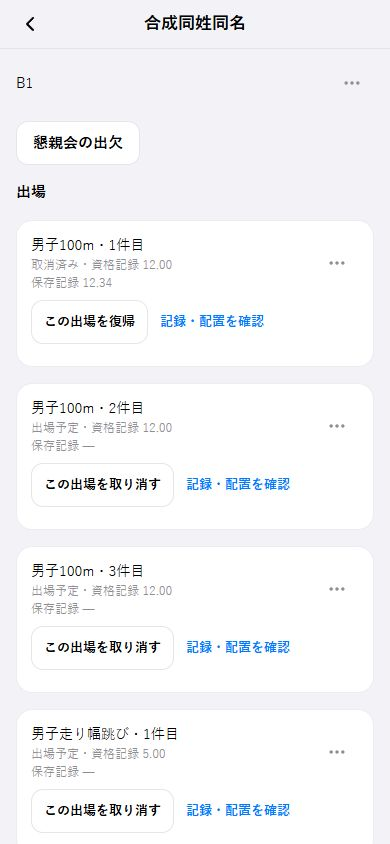

# 参加者・出場の分離と大会運営の共通化（2026-10-12）

## 開始・受入条件

- 所有者指示: 参加者と出場を分離し、既存の登録・記録・補助担当を保持。追加・複数出場・取消・削除・復帰を自然な操作にし、共通UIと別大会への再利用を実装する。
- 基準: fetch後のorigin/master `8949a6a`。独立worktree `.worktrees/meet-participants-20261012`。本体の既存変更と稼働中の依存は保持。
- 再現: 前日の調査・合成関数実行で、件数減少は2件目のみ取消、出場数を人数表示、取消後のDNS維持を確認。実アカウント/PWA操作は未再現。
- 人の大会参加、独立IDを持つ出場、種目設定、試技・配置、補助担当、懇親会を大会IDに紐付ける。氏名を一意キーにせず、本人IDは検証済み認証からのみ使う。
- 既存UUID・全出場の配置/試技/DNS・補助担当・回答・変更履歴を保持。取消と削除は履歴を保管し、復帰は同じ出場IDで未配置から行う。確定種目への変更、担当重複、無権限、古いrevisionを拒否。
- 追加→配置→記録→片方のみ取消→復帰、同姓同名の別人登録、未記録者/記録者の削除と復元、補助交代、別大会作成→同じ操作、保存失敗/結果不明/競合の復旧を受入試験とする。
- 既存OB専用データは移行原本として保全する。既存の出力・ホーム・予備同期の読書き経路も確認し、古い経路との並行正本を作らない。
- 本番migrationは対象確認・非公開snapshot・冪等dryRun/rollback・既存データ差分照合を先に行う。新しい書込み経路は本人用検証で確認してから切替える。

## 実装

大会IDを親に、参加者と出場を別テーブルへ分けた。参加者は本人アカウント・氏名・学年を持ち、出場は個別UUID・種目・通番・資格記録・申込状態・試技・配置を持つ。同じ参加者が同じ種目へ3件以上出場でき、氏名の一意制約を設けない。旧UUIDは参加者IDとして保持し、旧出場キーは移行対応表の `operation_key` に残す。

- 取消・出場削除は対象の出場だけを無効にし、配置を解除する。参加者削除は通常一覧から除く。いずれも試技・DNF/DQ・担当・回答・履歴を保持する。
- 復帰は同じIDを使い、未配置から再開する。参加者復帰後は出場ごとに復帰を選ぶ。確定済みの結果を変更する操作は拒否する。
- 担当は参加者を参照し、役割・時刻・内容・略称・既存IDの対応を保持する。出場との重複や欠席・削除中の担当は交代対象として示し、必要人数への充足から除く。出場追加時は重複の確認を挟み、担当を勝手に消さない。
- 本人の登録・資格記録・出場状況、担当者による管理、現役の記録入力、システム管理者の種目/担当ロール設定を分ける。既存OBの他人の登録管理は既存担当ロールに保持する。previewでは更新を拒否する。
- 更新は大会ごとの排他、対象のrevision、確認済み本人ID、固定request UUIDで処理する。結果不明時は操作を固定して照合し、未保存が確認できた場合だけ同じUUID/内容で明示的に再送する。保存先変更時は無条件で再送しない。
- 記録の競合は配置・出場状況・試技を別々に比較し、重ならない変更を保持する。途中で取消等になった出場の入力は、明示的な破棄確認なしに捨てない。その他の編集も、開いた時点のrevisionを保持し、知らない更新を上書きしない。

画面は「競技」「参加者」「補助担当」の共通SegmentedControlと、自分の登録の入口に整理した。書く操作はFormModal、編集/削除はActionMenu、確認はConfirmDialog、選択は共通Selectを使う。記録画面から出場を追加して戻る操作、男女の混合組、全体のフィールド試技順を保持する。表示件数は人数と出場件数を分ける。

別大会は大会詳細の「参加者・大会の運営」から種目・担当ロールを設定し、同じ `/competitions/[id]/manage` と同じDB/操作を使う。従来の公式プログラム・大会結果の経路は保持する。OB専用のシート公開だけは互換アダプタを使い、1出場を1行/1キーとして既存の公開・編集APIへ渡す。

## 移行と同期

新migrationは `20261012010000_competition_participants_appearances.sql`。最初は `ready=false` で取り込み、従来画面を継続する。切替時は両DBで旧書込みを止め、予備の旧変更を取り込んで残件0を確認する。最新原本のdigestを採り、同じトランザクションで原本を再取込・`ready=true` にする。以後、旧表は移行原本として保持し、通常の書込みを拒否する。切替前の取消は `source_frozen=false` に戻せる。切替後に新規更新が入った状態を、旧表への単純な差戻しで復旧しない。

PC→予備は1つのSQL snapshotで大会データを取得し、関連表を一括で適用する。予備→PCも大会単位の原子適用と、対象件数の確認後のjournal消込みを使う。配置の重複、失われた役割、部分適用、結果不明を拒否し、既存mirror-state・失敗行保護・元のOB履歴転送を維持する。初期取込は新しい予備側の利用者更新としてjournalへ積まない。

## 検証（切替前）

- 環境確認: Node.js 24.19.0、直接依存35件のlock一致。TypeScript・対象eslintを確認。
- 全Vitest: 143ファイル・1,246件成功。構造・Server Actions・別大会のSSR・高さ試技・競合・取得失敗・既存シートAPIを含む。
- 同期の運用試験: 16件成功。原子単位、主キー、正確な適用件数の確認、結果不明の保護を含む。
- 本番PCと予備クラウド: 対象10表の非公開snapshot後、migrationを2回実行し、SQL受入試験をROLLBACK。元の10表が不変であることを照合した。既存参加者・全保存済み出場・役割略称・回答の対応をSQLで照合した。
- SQL受入: 同姓同名の別人、3出場、独立記録、1件取消、IDを保つ復帰、DQ保持、担当交代、懇親会、確定保護、旧revision拒否、旧原本の書込み停止、シートdryRun/再送/別種目追加、同期の全体rollback。
- 合成ブラウザ: 追加から記録への復帰、個別取消、参加者削除/復帰、保存前切断・応答喪失の照合/明示再送、混合組と区分違いの移動拒否を確認。320px/390px幅の操作と44pxの対象を確認。実アカウントの認証、iOS/Android実機の操作は未確認。

本節は切替前の検証記録。Production build・master・両DBの適用・公開SHA・切替結果は終了追記で区別する。
